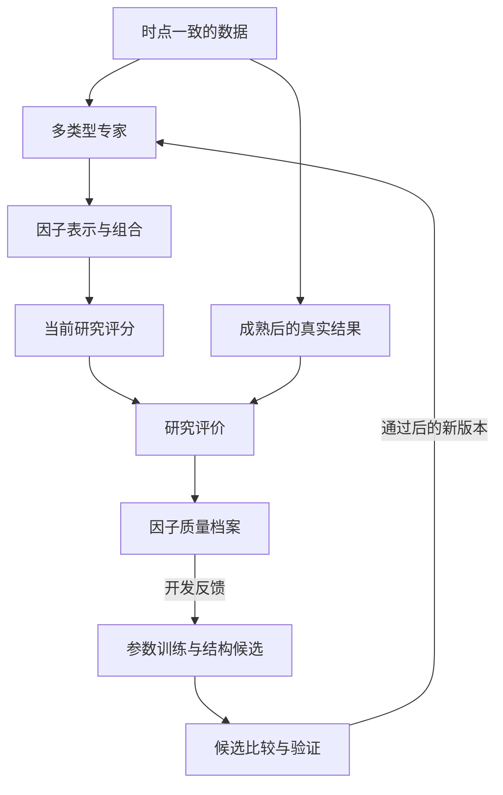

# 多专家因子发掘与迭代训练总体方案

总体设计第 1 版，2026 年 10 月 3 日。

本方案面向个人本地研究，建立一个能够生成因子、评价因子、学习因子之间的关系，并持续提出改进的研究平台。核心架构采用多类型专家、两层评分和有验证约束的迭代训练。系统的主要成果是可复现的因子库、面向不同研究任务的评分，以及支持这些结果的证据。

当前范围是因子发掘、评分与迭代训练，不包含持仓、交易决策、订单执行或以账户盈亏为目标的优化。本文件确定模块职责和研究流程，具体评分权重、网络规模、训练周期、数据窗口与统计门槛留待后续设计。

本方案作为后续讨论的总体依据。此前事件时间方案中的分布预测、信息时间约束和验证思路可以复用；其交易价值与持仓规则不纳入当前架构。现有代码和历史报告保持原样。本次交付仅形成设计，没有启动下载、模型训练或市场实验。

## 研究目标与成果

平台要回答三个问题：哪些数据关系值得表示为因子；哪些因子及其组合提供了新增信息；怎样调整参数或结构，才能让这种信息在新数据中继续有效。

初始研究背景为加密货币及期货的小时级数据。架构允许扩展其他标的和时间尺度，但不同市场需要独立确认数据含义、可用时间及评价适用性。多源输入按信息价值与数据质量逐步扩展，不以输入数量或矩阵维度作为成果指标。

最终形成三类成果：

- 因子库：保存因子的计算方式、训练版本、输入依赖、输出含义和适用条件。
- 研究评分：描述某一标的、某一时点的方向倾向、波动特征、市场状态或标的关系。
- 研究证据：说明因子在哪些任务和资料上有效，哪些尝试失败，以及新版本相对旧版本增加了什么。

高分表示在明确口径下取得了较好的研究结果，不等于已证明可交易、具有经济因果关系或能够盈利。

## 总体架构

平台由数据、专家、因子组合、研究评分、评价与迭代六项职责组成。原始输入经过专家形成因子表示，组合层按研究任务处理这些表示，评分层输出当前判断。真实结果可用后，评价层形成反馈，训练过程和研究 agent 据此提出下一版候选。

每项职责可以先由简单方法承担。模块化的目的在于比较和替换研究方法，不要求首版同时实现所有专家，也不要求每一层都是神经网络。

## 数据与信息时间

数据层保留数据来源、覆盖范围和实际可用时间，让历史研究能够重现当时可以知道的信息。价格、成交量、持仓量、资金费率和更细的成交资料都可作为候选输入，但只有取得可靠历史资料后才纳入对应研究。

输入缺失需要显式记录。缺少盘口数据时，不能把由价格和成交量推断的活跃度称为真实盘口流动性；相关的代理指标应保留其名称和限制。复杂数据源只有在提供可验证的新增信息时才值得加入。

用于当前专家组合的市场状态、标准化参数和质量记录，必须在当前时点可获得。未来结果仅进入已经成熟的训练标签或事后评价，不能成为过去预测的输入。

## 专家与因子的关系

专家是一种可学习的处理模块；因子是它从当前及历史资料中提取出的特征或表示。一个专家可以生成多个因子，同一个因子也可以服务多个研究任务。专家名称是初始分工，最终功能需要根据行为与实验解释。

原先设想的矩阵，在这里对应专家内部的参数与特征表示。模块可以学习输入变换、时间关系和非线性交互；增加矩阵或维度属于结构版本变化，需要比较新增部分的贡献。

保留两类专家：任务明确的专家便于单独检验，学习表示的专家允许发现预先没有写出公式的关系。前者可以输出明确评分或可解释因子，后者可以输出一组中间特征，再交给后续模块使用。

| 可选专家方向 | 研究重点 | 可能形成的表示 |
| --- | --- | --- |
| 方向与动量 | 变化的方向、延续和衰减 | 方向倾向、持续性特征 |
| 波动与压缩 | 波动程度及其变化 | 平静、压缩、扩张等表示 |
| 量价关系 | 成交活动与价格变化的联系 | 量价协调、异常活动特征 |
| 市场状态 | 趋势、震荡及关系转换 | 状态表示、转换倾向 |
| 标的间关系 | 同步、分化及领先关系 | 联动特征、相对偏离 |
| 持仓与资金活动 | 持仓量、资金费率等变化 | 资金活动与拥挤程度的代理表示 |
| 开放表示学习 | 预设任务未充分描述的数据结构 | 有待解释与验证的潜在因子 |

以上是候选职责，不是全部必建的清单，也不是现有原型的能力清单。首版应由数据条件支持的少量互补专家开始。

使用价格作为输入，不意味着专家必须预测涨跌。波动专家可以只研究未来波动，关系专家可以研究联动变化，状态专家可以辅助其他任务选择合适的特征。它们首先按自己的研究任务评价，再检查对组合系统的贡献。

开放表示不强求每个维度具有单独的经济名称。重训后内部坐标可能改变，应比较整个表示或功能，并保留版本差异；不能把相同维度编号直接视为同一个稳定因子。

## 因子组合与研究任务

组合层研究专家之间的互补、重复与适用条件。它可以采用简单组合，也可以学习随市场状态变化的组合关系。每项任务可以有自己的组合方式，不必共享一组通用权重。

组合权重反映模型如何使用某个表示，不自动等于因子的因果重要性或可靠概率。不同含义的原始输出不能直接求平均，例如方向与波动需要通过各自的任务接口解释，再由有明确目标的组合方法处理。

研究任务建议保持多样，包括未来方向或幅度、波动变化、成交活动、标的关系以及事件发生类型与时间。每项任务都需要明确目标含义和结果何时可用。任务可以共享部分表示，也允许保留专用部分；联合训练是否值得采用，需要与独立训练比较。

首次事件与时间分布作为其中一种任务保留，用来研究变化可能在什么尺度上出现。竞争风险与事件时间建模已有方法基础，但相关文献不证明本平台的因子有效。[DeepHit 原论文](https://ojs.aaai.org/index.php/AAAI/article/view/11842)

一些状态表示没有唯一真实标签。这类模块不能仅凭“能够识别自己定义的状态”获得高评价，需要通过稳定性、可复现性，以及对预先确定的其他任务的帮助来检验。同样，输入重构良好并不自动说明学到了关于未来的新增信息。

## 两层评分

### 因子质量评分

质量评分评价一个因子或模块在明确研究范围内的表现，为保留、继续探索或归档提供依据。评分对象不仅包括单个因子，也包括专家、因子组合和整个候选模型。

| 评价维度 | 核心问题 |
| --- | --- |
| 任务有效性 | 是否比简单参考方法更好地描述或预测目标？ |
| 增量价值 | 加入现有因子集合后，是否增加了有效信息？ |
| 条件稳定性 | 在其预先定义的适用环境中，结果能否重复出现？ |
| 泛化能力 | 换时间段或标的后，效果是否仍有支持？ |
| 复杂度与复现成本 | 增加的结构和计算是否值得，结果能否重现？ |

相关性低本身不能获得高评价，随机噪声也可能与现有因子不相关。增量价值要通过可比条件下的加入、移除或替换实验来判断。全局表现一般但在明确条件下有效的因子，可以标为条件适用，不必一律淘汰。

支持数据的覆盖范围、证据充分程度和不确定性单独展示，不与预测能力混成一个含义不明的分数。样本不足标为证据不足，缺测不当作零分。若只在某些标的或状态验证过，就限定其适用范围。

可以设置综合分用于同一任务和评价版本内的候选排序，但保留分项与原始指标。不同任务的分数不直接比较，评分映射与参照标准保持版本化，避免候选变化使历史分数无故改变。高分不能抵消数据泄漏、时间顺序错误或无法复现等资格问题。

因子评价可以参考 Alphalens 的信息相关性与分组分析思路，但本平台需要为波动、状态和其他任务分别选择评价方式。少量标的的时序研究也不能直接照搬大规模股票截面的评价解释。[Alphalens 官方说明](https://github.com/quantopian/alphalens)

### 当前研究评分

当前研究评分描述模型在特定信息时点形成的判断。建议保留多个有明确含义的维度，例如方向倾向、持续性、波动活跃程度、事件倾向和标的联动，不压缩成一个通用的“好坏分”。

每项评分附带目标、时间尺度、模型版本和输入完整性。若采用区间分数，需要说明它代表相对强弱、标准化位置还是其他含义。只有明确预测概率并经过相应检验的输出，才能按概率解释；一般分数不能直接称为胜率。

专家一致程度可以作为诊断，但一致不等于正确，也不自动构成置信度。当前判断的强弱与因子长期质量分别记录：一个经过验证的因子可以在当前时刻表现中性，一个尚未充分验证的因子也可能输出很强的信号。

这两层评分通过未来成熟结果联系起来。当前评分产生可核查的历史记录，因子质量评分依据这些记录及相应结果更新，不用修改过去评分来追认模型正确。

## 参数学习与结构迭代

参数学习改善已有计算结构，包括专家内部的数据变换、不同历史信息的使用方式、因子间交互和任务组合。训练使用与任务含义相符的目标，按需要独立训练或联合训练；各任务结果分别保留，避免平均改善掩盖某项任务的退化。

质量评分用于比较候选，并不要求把整张评分表直接变成一个反向传播目标。可训练目标与外部研究评价各有职责：前者形成模型，后者检查改善是否能够离开训练资料仍然成立。

结构迭代允许改变输入集合、表示维度、专家分工、连接关系和学习方法。可以增添，也可以删除、替换或简化。一次结构修改应当有清楚的研究理由，让实验能够回答新增复杂度带来了什么。

| 变化层次 | 学习或研究内容 | 判断依据 |
| --- | --- | --- |
| 参数变化 | 现有专家和组合内部的可学习参数 | 相应任务的学习目标及开发评价 |
| 组合变化 | 专家如何协作及何时发挥作用 | 同一任务下的增量价值与稳定性 |
| 结构变化 | 因子、维度、专家或方法的增删替换 | 与原版本及简单替代方案的独立比较 |

平台首先保留固定版本作为对照，再研究按既定规则滚动更新的版本。模型可以随成熟数据更新，更新规则本身需要先约定。过去发布的因子值、研究评分和版本记录保持不变；更新只影响之后的输出。

## 研究 agent 的职责

研究 agent 使用开发记录寻找可检验的问题，例如某些专家高度重复、某类状态下表现不稳定、某个数据来源可能提供缺失信息。它的成果是候选假设、结构提案和对照实验安排，因子评分由确定的评价过程计算。

每项提案说明拟解决的问题、修改对象、比较对象和保留或放弃的依据。agent 可以调整模型，但不能为了让某个候选胜出而自行更换评分口径、目标定义或验证资料。

默认保持不变是正常结果。若简单参考方法已经达到相近表现，系统应接受简化；若增加维度只改善训练分数，应记录这次失败并停止沿用该结论。

评分体系本身也可以作为独立研究对象改进，但需要单独版本并重新建立可比性。不能在同一次搜索中让候选结构与评分尺子一起任意改变。

## 验证与反馈隔离

研究循环分为可反复使用的开发评价，以及用于确认的独立验证。开发评价帮助选择和修改候选；独立验证用于检验冻结候选，不能反复泄露给搜索过程来继续优化同一份资料。

使用按时间推进的研究记录。对于需要等待未来结果的任务，先形成评分，结果成熟后才允许训练或评价。重叠窗口、共同市场变化和同一时刻多个标的造成的相关性，需要在后续统计设计中处理，不能将所有样本行视为独立证据。

候选比较应匹配输入可用性、任务、资料区间及训练资源，并明确新增的数据或模型容量。必须保留简单方法、固定组合与删除模块的对照；结构搜索开放后，还要检查 agent 是否优于可比预算的简单搜索。

完整记录开发尝试，包括失败和放弃的版本。反复搜索可能选出只适合历史噪声的候选，因此单次高分和训练改善不足以证明发现了有效因子。[回测过拟合研究](https://www.davidhbailey.com/dhbpapers/backtest-prob.pdf)

独立验证资料一经查看，无论结果成功还是失败，都登记为已用。后续可以开展新研究，但不能依据该结果继续调整结构，再用同一资料声称获得新的独立确认。证据不足、没有新增贡献、仅在局部条件有效，均是合法结论，不强制系统持续制造“更好”的因子。

## 因子档案与研究输出

每个因子或表示模块保留一份研究档案，使后续研究能够理解和复现其来源。

| 档案内容 | 用途 |
| --- | --- |
| 计算结构与输入依赖 | 说明因子如何产生及需要哪些资料 |
| 输出含义与任务关系 | 区分可解释因子、潜在表示和研究评分 |
| 训练版本与可用时间 | 还原某次研究使用的实际模型 |
| 分项质量与证据范围 | 说明在哪些任务、标的和环境中得到支持 |
| 增量贡献与替代关系 | 识别互补、冗余及可被简单方法替代的部分 |
| 版本谱系与研究状态 | 保留修改原因、验证结果和归档依据 |

研究档案分别记录验证阶段、适用范围和证据充分程度。例如，某因子可以已在特定市场状态通过独立验证，同时仍缺少跨标的证据。这些描述可以并存，不压缩为一个互斥的状态标签。保留或归档也单独记录，验证结论仅针对声明的研究任务与资料范围。

平台同时提供当前研究评分与历史评分档案。查看者能够区分模型当时的判断、后来获得的结果，以及系统据此形成的质量评价。

## 推进顺序

首先建立少量研究任务及简单参考方法，让评分含义清楚、因子能够复现。随后加入少量职责互补的专家，检验模块化是否确实优于简单整体模型和固定组合。

当专家及组合的增量价值得到支持后，再比较固定训练与滚动更新。更新机制成立后，开放有边界的结构探索，让 agent 尝试改变维度、专家或学习方法。

每一步都允许保留简单方案，后一步也不以规模扩大为成功标准。此顺序用于降低归因困难；具体工程安排和资源预算在后续设计中确定。

## 当前结论与待定事项

本方案确定多类型专家并存、任务化组合、两层评分和可追踪迭代的总体路线。专家不全部承担价格预测，事件时间只是一种研究任务，评分系统为因子研究提供反馈。

尚待后续确定的是首批数据和任务、最小专家集合、各任务的指标与评分映射，以及训练更新和结构比较的具体协议。这些选择应围绕能否识别新增信息展开，不先追求极大的维度或复杂的网络。

当前文件是总体设计，不是已经验证的模型。全部项目文件继续保存在 D:/FactorResearch；本方案形成后，下一阶段仍可先做设计比较，再决定具体实现。
